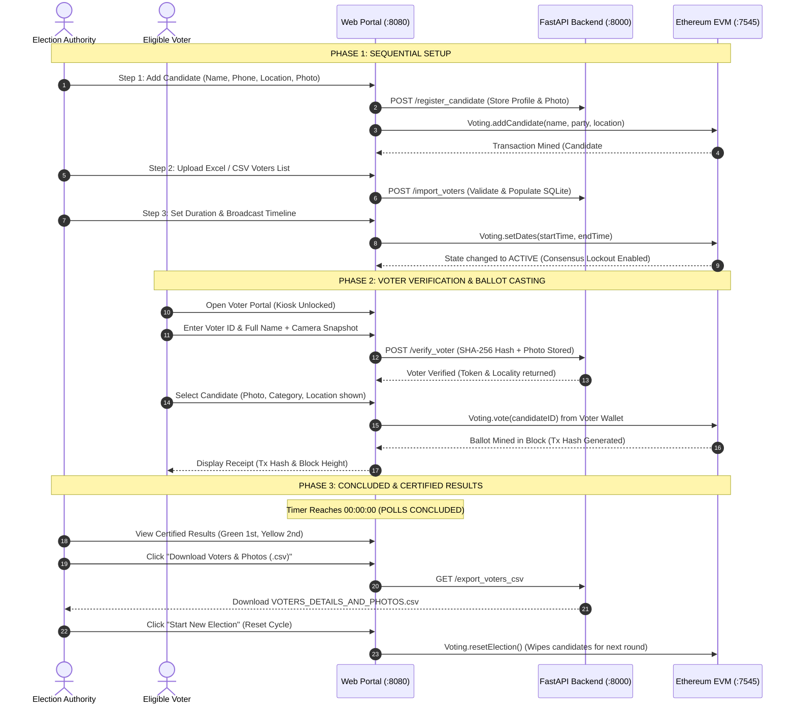

# Decentralized Voting System on Ethereum Blockchain
## Complete Project Master Document & Presentation (PPT) Blueprint

> **Purpose:** This document contains the complete technical specification, architectural design, workflows, functional breakdown, live demonstration guide, viva questions, and a ready-to-use **slide-by-slide PowerPoint (PPT) script** for presentations and project evaluations.

---

## 📌 Table of Contents
1. [Project Overview & Executive Summary](#1-project-overview--executive-summary)
2. [Problem Statement & Proposed Solution](#2-problem-statement--proposed-solution)
3. [Key Features & Functional Modules](#3-key-features--functional-modules)
4. [System Architecture & Data Flow](#4-system-architecture--data-flow)
5. [End-to-End Workflow & Lifecycle](#5-end-to-end-workflow--lifecycle)
6. [Slide-by-Slide PowerPoint (PPT) Presentation Blueprint](#6-slide-by-slide-powerpoint-ppt-presentation-blueprint)
7. [Live Demonstration Script (2-Minute Viva Walkthrough)](#7-live-demonstration-script-2-minute-viva-walkthrough)
8. [Examiner / Viva Q&A Guide (Top 10 Questions & Answers)](#8-examiner--viva-qa-guide-top-10-questions--answers)
9. [Technology Stack Breakdown](#9-technology-stack-breakdown)

---

## 1. Project Overview & Executive Summary

* **Project Title:** Decentralized Voting System using Ethereum Blockchain & Biometric Verification
* **Domain:** Blockchain Technology, Distributed Ledger Technology (DLT), Web3, Smart Contracts, Cyber Security
* **Target Audience:** Universities, Colleges, Corporate Boards, Student Unions, NGOs, and Civic Organizations
* **Core Philosophy:** *Trustless, Tamper-proof, Transparent, and Verifiable Democratic Balloting without Intermediaries.*

### Executive Summary
Traditional digital voting systems rely heavily on centralized databases (e.g., MySQL, Oracle, Cloud SQL) managed by a central authority. These centralized setups are vulnerable to internal database manipulation, administrator tampering, data loss, and unauthorized vote altering. 

This **Decentralized Voting System** replaces vulnerable centralized vote tallying with an **Ethereum Virtual Machine (EVM) Smart Contract**. Every cast ballot is permanently sealed into an immutable block. Once mined into the blockchain, neither election authorities nor external attackers can alter or forge vote totals. The platform combines on-chain immutability with off-chain biometric camera verification (SHA-256 image fingerprinting), strict consensus lockouts, live secrecy to eliminate bandwagon bias, and automated cryptographic audit exports.

---

## 2. Problem Statement & Proposed Solution

### The Problem (Centralized Voting Vulnerabilities)
1. **Single Point of Failure (SPOF):** If the central server crashes or is compromised, the integrity of the election is destroyed.
2. **Admin Database Alteration:** Anyone with direct root or SQL access (`UPDATE candidates SET votes = votes + 50`) can silently modify results with zero trace.
3. **Lack of Trust & Transparency:** Electors cannot mathematically verify that their specific vote was tallied accurately.
4. **Bandwagon Bias:** Real-time percentage counters bias undecided voters during active election windows.
5. **Voter Impersonation:** Lack of real-time identity snapshots allows credential sharing or fraudulent proxy voting.

### The Proposed Solution
1. **Immutable Smart Contract Ledger (`Voting.sol`):** State transitions and vote counters are maintained on the blockchain via cryptographically validated transactions.
2. **Consensus Lockout Protocol:** When the election timer begins, candidate rosters and voter lists are automatically locked across both the blockchain and the database.
3. **Biometric Camera Verification:** Real-time webcam snapshots captured during voter authentication are hashed via SHA-256 for non-repudiation and exportable post-election audits.
4. **Zero-Knowledge Live Secrecy:** Vote tallies remain strictly hidden during active balloting and are only decrypted/certified upon countdown expiration.
5. **Decentralized Auditability:** Evaluators can inspect raw transactions, block hashes, and gas usage directly in Ganache or any EVM block explorer.

---

## 3. Key Features & Functional Modules

### Module 1: Smart Contract Engine (`contracts/Voting.sol`)
* **State Machine:** Governed by an explicit lifecycle: `SETUP ➔ ACTIVE ➔ CONCLUDED`.
* **Tamper-Proof Voting (`vote` function):** Checks election timeline, validates candidate ID, verifies the cryptographic address has not voted in the active round, and increments `voteCount` atomically.
* **On-Chain Candidate Storage:** Stores candidate ID, full name, category/party, and location on the decentralized ledger.
* **Multi-Round Election Reset:** Enables election authorities to wipe candidate storage and increment `electionRound` while preserving previous receipts.

### Module 2: 3-Step Guided Admin Setup (`src/html/admin.html`)
* **Step 1: Add Candidates:**
  * Requires: First Name, Last Name, Phone Number, Location/Region, Category/Party, and Bio.
  * Integrated **Webcam Capture** with instant canvas preview and SHA-256 fingerprint (with file upload fallback).
  * Registers candidate details in the backend database and calls `Voting.addCandidate(...)` on Ethereum.
* **Step 2: Upload Voters Roster:**
  * Drag-and-drop spreadsheet upload (`.xlsx`, `.xls`, `.csv`).
  * Validates `Unique_ID`, `Full_Name`, and `Locality` using client-side SheetJS parsing.
  * Downloadable sample template for instant testing.
* **Step 3: Customizable Countdown Timer:**
  * Configurable in Days, Hours, Minutes, and Seconds.
  * Quick presets: 1 Min (testing), 5 Mins, 1 Hour, 24 Hours.
  * Broadcasting timeline broadcasts start and end timestamps directly to `Voting.sol` and triggers the live countdown ticker.

### Module 3: Consensus Lockout Protocol
* As soon as voting becomes active, the administrator dashboard is locked:
  * Adding or removing candidates is disabled.
  * Uploading or modifying voter lists is blocked (`403 Forbidden` on backend).
  * Timeline adjustments are frozen until the timer reaches `00:00:00`.

### Module 4: Biometric Voter Verification & Ballot Portal (`src/html/index.html`)
* **Prerequisite Gating:** The citizen enrollment screen is hidden until all 3 admin setup steps are confirmed complete and the timer is active.
* **Live Camera Snapshot:** Snaps the citizen's picture, calculates an SHA-256 cryptographic digest, and logs it to the verification audit table.
* **Rich Ballot Cards:** Displays each candidate's real captured photo, category, and location directly on the ballot.
* **Cryptographic Receipt:** Once cast, voters receive an instant transaction confirmation popup with the exact **Transaction Hash** and **Mined Block Number**.

### Module 5: Results Certification & Audit Trail
* **Automated Conclusion:** Automatically transitions to `POLLS CONCLUDED` when the timer expires.
* **Podium Highlights:** Highlights 1st Place (**Green**) and 2nd Place (**Yellow**) without emojis, along with vote counts, percentage share, and full rankings table.
* **CSV Audit Export:** One-click download of `VOTERS_DETAILS_AND_PHOTOS.csv` containing Voter ID, Full Name, Verification Status, Photo URL, SHA-256 Hash, and UTC Timestamp.

---

## 4. System Architecture & Data Flow

```mermaid
flowchart TD
    subgraph ClientLayer ["Client Layer (Browser)"]
        AdminUI["Admin Dashboard (admin.html)"]
        VoterUI["Voter Portal (index.html)"]
        Webcam["Webcam & Canvas (SHA-256 Photo Capture)"]
    end

    subgraph AppServer ["Application & Web3 Layer"]
        Express["Express.js Server (Port 8080)"]
        Web3["Web3.js & Truffle Contract Provider"]
        FastAPI["FastAPI Backend Server (Port 8000)"]
    end

    subgraph StorageLayer ["Data & Blockchain Layer"]
        SQLite["SQLite Database (voter_db.sqlite)"]
        Photos["Captured Photos Storage (/captured_photos)"]
        Ganache["Ethereum EVM Blockchain (Ganache Port 7545)"]
        SmartContract["Voting.sol Smart Contract"]
    end

    AdminUI -->|Manage Setup & Timeline| Express
    VoterUI -->|Load Kiosk & Ballot| Express
    Webcam -->|Base64 Biometric Stream| FastAPI
    
    FastAPI -->|Store Electors & Audit Logs| SQLite
    FastAPI -->|Save Candidate & Voter Images| Photos
    
    AdminUI -->|addCandidate / setDates| Web3
    VoterUI -->|vote candidateID| Web3
    Web3 -->|RPC Calls (Port 8545/7545)| Ganache
    Ganache -->|Execute State Transition| SmartContract
```

---

## 5. End-to-End Workflow & Lifecycle



---

## 6. Slide-by-Slide PowerPoint (PPT) Presentation Blueprint

Use this section to construct your PowerPoint presentation. Each slide provides the exact title, slide content bullets, visual layout suggestions, and spoken presentation notes.

---

### Slide 1: Title Slide
* **Slide Title:** Decentralized Voting System Using Ethereum Blockchain
* **Subtitle:** A Tamper-Proof, Biometrically Audited E-Voting Architecture for Modern Governance
* **Presented By:** [Your Name / Team Members]
* **Guide / Supervisor:** [Supervisor / Professor Name]
* **Department / Institution:** [Department of Computer Science & Engineering / Institution Name]
* **Speaker Notes:**  
  *"Good morning respected evaluators and professors. Today, we are presenting our project: A Decentralized Voting System using Ethereum Blockchain. Our project solves the critical issues of mistrust, database tampering, and lack of transparency inherent in traditional electronic voting systems."*

---

### Slide 2: Background & Motivation
* **Key Points:**
  * Democratic voting is the foundation of any election—from student bodies to civic institutions.
  * Centralized electronic voting machines (EVMs) and web databases operate as "black boxes."
  * Lack of voter verification and transparent auditing leads to contested election results.
  * **Core Question:** *How can we guarantee that votes cannot be changed after being cast, while maintaining complete ballot secrecy?*
* **Visual:** Split screen showing "Paper Ballots (Slow, vulnerable)" vs "Centralized DB (Hackable, Admin-altered)" vs "Blockchain (Immutable, Transparent)".
* **Speaker Notes:**  
  *"Traditional paper voting is slow and resource-intensive, while centralized databases place total trust in database administrators. If an admin has root access to a database, they can execute a single SQL query to alter vote counts undetected. Our motivation was to build a system where integrity is guaranteed by cryptographic mathematics rather than blind trust."*

---

### Slide 3: Problem Statement
* **Key Points:**
  * **Single Point of Failure (SPOF):** Vulnerable to server crashes and localized cyberattacks.
  * **Silent Data Manipulation:** Traditional databases have no built-in immutability.
  * **Bandwagon Bias:** Showing live vote counts sways voter decisions in real time.
  * **Proxy Voting / Identity Theft:** Credentials can be shared if live verification is absent.
  * **Audit Deficit:** No exportable cryptographic link connecting voter authorization to ballot timestamps.
* **Visual:** Warning icons representing SQL Injection, Database Overwrite, and Unauthorized Proxy Voting.
* **Speaker Notes:**  
  *"Here we summarize the four core vulnerabilities of centralized systems: first, administrators can alter tables; second, live result leaks induce bandwagon bias; third, lack of real-time image capture allows voter impersonation; and fourth, there is no mathematical proof of a tamper-proof audit trail."*

---

### Slide 4: Proposed Solution & Objectives
* **Key Points:**
  * **Smart Contract Core:** Ethereum Smart Contract (`Voting.sol`) acts as the autonomous election authority.
  * **Decentralized Ledger:** Every vote is permanently sealed as an Ethereum transaction.
  * **Biometric Camera Audit:** Live webcam capture with SHA-256 hashing during voter login.
  * **Sequential 3-Step Setup:** Candidates ➔ Voters Spreadsheet ➔ Customizable Timer.
  * **Consensus Lockout:** Freezes candidate and database modifications as soon as polls open.
  * **Post-Election Certification:** Certified 1st and 2nd place highlights with full CSV audit report.
* **Visual:** Checkmark list illustrating the five core security pillars.
* **Speaker Notes:**  
  *"Our proposed solution introduces a hybrid Web3 architecture. We place vote counting and election state exclusively on the Ethereum blockchain, while managing identity verification and photo hashing through a lightweight, secure FastAPI backend. Everything follows a structured 3-step setup, ensuring total consensus lockout while polls are active."*

---

### Slide 5: System Architecture & Technology Stack
* **Key Points:**
  * **Smart Contract Layer:** Solidity (`^0.5.15`), Truffle Suite, Ganache EVM.
  * **Web3 Integration:** Web3.js, `@truffle/contract`, Browserify.
  * **Backend & API:** Python 3.11, FastAPI, Uvicorn, PyJWT.
  * **Embedded Database:** SQLite3 (No external database setup required).
  * **Frontend:** Responsive HTML5/CSS3, SheetJS for client-side Excel parsing, WebRTC Camera API.
  * **Web Server:** Node.js & Express (Port `8080`).
* **Visual:** Block diagram showing Frontend ➔ Web3.js & FastAPI ➔ Ethereum Ganache & SQLite.
* **Speaker Notes:**  
  *"Our tech stack combines the best of decentralized and modern web technologies. We use Solidity for the smart contract, Truffle and Ganache for the Ethereum EVM environment, Web3.js to sign and broadcast transactions, and Python FastAPI with embedded SQLite for high-speed voter verification and photo hashing."*

---

### Slide 6: Smart Contract Design (`Voting.sol`)
* **Key Points:**
  * **State Machine Pattern:**
    * `SETUP` (Initial configuration)
    * `ACTIVE` (Polls open, state locked)
    * `CONCLUDED` (Polls closed, results certified)
  * **Anti-Duplicate Mechanism:** `roundVoterReceipts[electionRound][msg.sender].hasVoted` ensures one wallet = one vote per election round.
  * **Candidate Data Structure:**
    * `uint id`, `string name`, `string party`, `string manifesto`, `uint voteCount`.
  * **Cycle Reset Function:** `resetElection()` deletes candidate arrays and increments round counters for fresh elections without redeploying.
* **Visual:** Code snippet of `struct Candidate` and the `vote()` require statements.
* **Speaker Notes:**  
  *"At the heart of our solution is Voting.sol. It uses an explicit state machine pattern. The vote function enforces strict checks: it verifies that the current timestamp is within the voting window, confirms the candidate exists, and validates that the voter's Ethereum address has not already cast a ballot. Duplicate voting is mathematically rejected at the EVM bytecode level."*

---

### Slide 7: Admin Workflow (3-Step Guided Setup)
* **Key Points:**
  * **Step 1: Nominate Candidates:** First Name, Last Name, Phone, Location, Party, Bio, and live Webcam/Upload photo with SHA-256 validation.
  * **Step 2: Upload Voters List:** Upload Excel (`.xlsx`) or CSV sheet of eligible voters. Built-in template generator available.
  * **Step 3: Program Timeline & Launch:** Configure Days, Hours, Minutes, and Seconds (e.g. 5 Mins) and click Broadcast Timeline.
  * **Consensus Lockout Enforced:** Candidate creation, database uploads, and timer controls lock immediately upon launch.
* **Visual:** Screenshots of Step 1, Step 2, and Step 3 from the actual admin interface.
* **Speaker Notes:**  
  *"The administrator dashboard enforces a strict sequential setup workflow. The admin cannot jump straight to starting the election. They must first add candidates with verified photos and phone numbers, then upload the eligible voter spreadsheet, and finally set the customized countdown timer. Once launched, the dashboard enters lockdown mode."*

---

### Slide 8: Voter Verification & Balloting Experience
* **Key Points:**
  * **Prerequisite Lock:** The voter station is hidden until candidates, voter roster, and active timeline are all verified.
  * **Facial Snapshot Capture:** The voter inputs their Name and Voter ID; the webcam captures a live picture and generates a SHA-256 hash.
  * **Visual Ballot Cards:** Electors see real candidate photos, party names, and regional locations before selecting.
  * **Cryptographic Receipt:** On submission, the voter receives a popup displaying their **Transaction Hash** and **Mined Block Number**.
* **Visual:** Screenshot of the live camera feed on the voter portal and the resulting transaction confirmation receipt.
* **Speaker Notes:**  
  *"On the voter side, electors cannot vote until the admin fulfills all prerequisites. During enrollment, the front camera takes a verification photo and creates a cryptographic hash. The voter selects their candidate from rich visual cards and casts their ballot. A permanent transaction receipt is generated instantly."*

---

### Slide 9: Live Ballot Secrecy & Bandwagon Prevention
* **Key Points:**
  * Traditional elections suffer from **Bandwagon Bias** when trending counts influence late voters.
  * **Zero Live Counts:** In this system, neither administrators nor voters can view live vote counts while the timer is running.
  * The smart contract accumulates counts privately in internal storage slots.
  * Official counts and standings unlock automatically the exact second the countdown reaches `00:00:00`.
* **Visual:** Illustration comparing "Biased Live Counters" vs "Protected Blind Voting" during active polls.
* **Speaker Notes:**  
  *"A critical design requirement in our project is preserving voting psychology. Many digital voting apps display live percentages, causing undecided voters to simply pick the winning candidate. In our platform, live counts are completely suppressed during the active voting window, guaranteeing private, uninfluenced balloting."*

---

### Slide 10: Certified Results & Comprehensive CSV Audit
* **Key Points:**
  * **Automatic Status Transition:** Switches from `POLLS ACTIVE` to `POLLS CONCLUDED • CERTIFIED RESULTS`.
  * **Official Podium Highlights:**
    * 1st Place (Highest Votes) highlighted in **Green**.
    * 2nd Place (Runner-up) highlighted in **Yellow**.
  * **Exportable Audit Trail:** One-click download of `VOTERS_DETAILS_AND_PHOTOS.csv` containing:
    * `Voter_ID`, `Full_Name`, `Locality`, `Verification_Status`, `Photo_Filename`, `Photo_URL`, `SHA256_Hash`, `Verification_Timestamp`.
  * **Election Reset Option:** Reinitializes candidates and logs for the next election round.
* **Visual:** Screenshot of the Final Results card and a sample snippet of the generated CSV file.
* **Speaker Notes:**  
  *"When the timer expires, the results section appears automatically. The winner is styled in clean green and the runner-up in yellow, without emoji trophies. Administrators can download a complete CSV audit file that correlates every voter with their captured photo URL and SHA-256 hash for forensic auditing."*

---

### Slide 11: Security & Cryptographic Analysis
* **Key Points:**
  * **Immutability:** Ethereum blockchain guarantees transactions cannot be reversed or altered.
  * **SHA-256 Hashing:** Tamper-evident biometric audit log prevents photo substitution.
  * **Double-Voting Prevention:** Smart contract mapping checks `hasVoted` per round.
  * **JWT Authentication:** Secure admin session management.
  * **Zero External DB Dependency:** SQLite runs embedded in Python, eliminating MySQL injection/configuration issues.
* **Visual:** Security matrix summarizing Threats vs Blockchain Defenses.
* **Speaker Notes:**  
  *"From a security standpoint, our system eliminates the top attack vectors. Double voting is rejected by the smart contract. Candidate tampering is prevented by consensus lockout. Photo tampering is caught through SHA-256 hashing, and the system runs zero-configuration SQLite to eliminate external database vulnerabilities."*

---

### Slide 12: Live Demonstration & Ganache Inspection
* **Key Points:**
  * **Ganache RPC Server:** Shows local EVM running on `HTTP://127.0.0.1:7545` (Network ID `5777`).
  * **Blocks Tab:** Demonstrates block height incrementing with each vote cast (`TXS: 1` per block).
  * **Transactions Tab:** Displays transaction hash, sender address, and contract call to `Voting.sol`.
  * **Accounts Tab:** Demonstrates gas consumption on voter accounts (`~99.98 ETH`), proving execution on an EVM ledger.
* **Visual:** Side-by-side screenshot showing the Web App ballot receipt and the matching transaction hash in the Ganache GUI.
* **Speaker Notes:**  
  *"During our live demo, we prove the blockchain integration in Ganache. When a vote is cast on the web portal, the current block height increments immediately in Ganache, and the transaction hash shown on the voter's screen matches the transaction hash mined on the EVM ledger."*

---

### Slide 13: Advantages, Real-World Impact & Future Scope
* **Key Points:**
  * **Advantages:**
    * Eliminates server administrator bias.
    * 100% auditable with exportable CSV logs.
    * Highly adaptable (Colleges, Corporate AGMs, Clubs, Student Unions).
  * **Future Enhancements:**
    * Deployment to Ethereum Layer-2 testnets (Polygon / Arbitrum / Sepolia).
    * Integration of Zero-Knowledge Proofs (zk-SNARKs) for complete anonymity.
    * Decentralized photo storage via IPFS (InterPlanetary File System).
* **Visual:** Roadmap diagram showing Local Ganache ➔ L2 Testnets ➔ IPFS & zk-SNARKs.
* **Speaker Notes:**  
  *"Our platform is immediately deployable for campus elections, corporate shareholder voting, and organizational governance. Future enhancements include hosting photos on IPFS and migrating from local Ganache to Ethereum Layer-2 networks like Polygon to minimize gas costs in large-scale elections."*

---

### Slide 14: Conclusion & Q&A
* **Key Points:**
  * Decentralized voting bridges the gap between digital convenience and cryptographic trust.
  * Replaces vulnerable centralized databases with immutable Ethereum smart contracts.
  * Successfully combines biometric verification, consensus lockouts, and automated audit trails.
* **Closing:** Thank you! We welcome any questions from the panel.
* **Speaker Notes:**  
  *"In conclusion, our project demonstrates that blockchain technology can restore absolute trust to digital voting. Thank you for your time, and we are now open to your questions."*

---

## 7. Live Demonstration Script (2-Minute Viva Walkthrough)

Follow this exact sequence when demonstrating the project to an examiner or evaluator:

| Step | Action | What to Explain to the Examiner |
|---|---|---|
| **0:00 - 0:25** | Open `http://localhost:8080`, log in as `admin` (`admin123`). | *"Here is the Admin Dashboard. Notice the sequential 3-step setup wizard. Step 1 allows us to register candidates with full name, phone number, location, and a live camera snapshot."* |
| **0:25 - 0:45** | Snap a candidate photo, click **Register Candidate**, upload voters list (`VOTEX_Sample_Voters_Template.csv`), set timer to 1 minute, and click **Start Polls**. | *"Notice that once the timer starts, the admin dashboard enters consensus lockdown. Neither candidates nor voter lists can be modified while polls are active."* |
| **0:45 - 1:15** | Open `http://localhost:8080/index.html` in an incognito or separate window. | *"Now we are on the Voter Kiosk. It was unlocked only because all 3 prerequisites were met. We enter Voter ID `VOT-2026-101`, let the camera capture our verification photo, and proceed."* |
| **1:15 - 1:35** | Select the candidate card (pointing out candidate photo and location) and click **Vote**. Show receipt. | *"Here are the candidate cards showing their real photos and locations. We select our candidate and vote. Notice the receipt popup: it gives us the mined Block Number and Transaction Hash."* |
| **1:35 - 1:50** | Switch to the **Ganache** desktop application. | *"Now look at Ganache: Current Block has incremented, and in the TRANSACTIONS tab, this exact transaction hash was mined by the smart contract on our local blockchain."* |
| **1:50 - 2:00** | Wait for the timer to reach 00:00:00 on the admin page. | *"The countdown has finished. Polls are now concluded. Here are the certified results: 1st Place in Green, 2nd Place in Yellow. Finally, we click 'Download Voters & Photos' to export the complete CSV audit trail."* |

---

## 8. Examiner / Viva Q&A Guide (Top 10 Questions & Answers)

### Q1: How do I know this project is actually using a blockchain and not just a database?
> **Answer:** In the Ganache application, you can observe every state-changing action (contract deployment, setting election dates, registering candidates, and casting votes). Each vote creates a mined Ethereum transaction with a unique 66-character **TX Hash**, gas consumption, and a cryptographic link to the parent block hash. If you shut down the backend database, the smart contract on Ganache still retains every vote cast.

### Q2: Why does the admin page get locked while voting is in progress?
> **Answer:** This implements the **Consensus Lockout Protocol**. In a fair election, an authority must never be able to add a favored candidate halfway through voting, delete an opposing candidate, or inject extra voter IDs into the eligible list. Locking the controls ensures the parameters established at the start remain immutable until the timeline expires.

### Q3: Can an administrator manually change the vote counts in the database?
> **Answer:** No. Vote counts are **never** stored in the SQLite database. SQLite only stores eligible voter identity lists and captured photo audit logs. The vote count exists solely inside the storage slots of the compiled Ethereum smart contract (`Voting.sol`). Changing the SQLite database has zero effect on the on-chain vote tally.

### Q4: Why do you capture photos and hash them with SHA-256?
> **Answer:** Hashing the photo with SHA-256 provides cryptographic **non-repudiation**. If an elector claims someone else voted in their name, the election authority can inspect the audit log. The SHA-256 hash guarantees that the stored snapshot was not swapped or edited after the ballot was cast.

### Q5: Why are live vote percentages hidden while polls are active?
> **Answer:** To prevent **Bandwagon Effect (Voting Bias)**. Behavioral science shows that when voters see one candidate leading by 70%, undecided voters tend to vote for the expected winner or refrain from voting altogether. Suppressing live vote counts ensures every citizen votes based on merit rather than trend momentum.

### Q6: What happens when the election ends or resets?
> **Answer:** When the timer reaches `00:00:00`, the smart contract enters the `CONCLUDED` state, and the frontend automatically reveals the certified winner (Green) and runner-up (Yellow). When the admin clicks **Start New Election**, `Voting.sol` calls `resetElection()`, which wipes the candidate array, clears the photo audit logs, increments `electionRound`, and restores the system to `SETUP` mode for the next election.

### Q7: Why do voter accounts spend gas?
> **Answer:** In the Ethereum Virtual Machine (EVM), writing data to state storage requires computational work and transaction execution, which is quantified as **Gas**. In our local Ganache test environment, each imported voter account is allocated test ETH. Spending a fraction of test ETH (e.g., `0.0004 ETH`) proves that a legitimate EVM transaction was executed.

### Q8: Why use both FastAPI (Python) and Ethereum Smart Contracts?
> **Answer:** This is standard Web3 hybrid architecture:
* **Ethereum Blockchain:** Handles mission-critical, tamper-sensitive logic (ballot counting, immutability, duplicate vote rejection).
* **FastAPI Backend:** Handles high-throughput, data-heavy operations that would be prohibitively expensive to store on-chain (spreadsheet parsing, high-resolution photo file hosting, SHA-256 hashing, and CSV file streaming).

### Q9: How is duplicate voting prevented?
> **Answer:** Duplicate voting is prevented on two independent layers:
1. **Frontend / Application Layer:** The voter ID is validated against the eligible roster and marked as having participated.
2. **Blockchain Layer (Smart Contract):** `Voting.sol` uses the mapping `mapping (uint => mapping(address => VoterReceipt)) public roundVoterReceipts;`. If the same Ethereum wallet address attempts to execute `vote()` a second time, the smart contract throws a `revert("Cryptographic address has already cast a ballot in this round")` exception, rejecting the transaction.

### Q10: How does this scale to real-world national or university elections?
> **Answer:** For enterprise or campus deployment, the local Ganache provider is swapped for an **Ethereum Layer-2 rollup** (such as Polygon PoS, Arbitrum, or Base) in `truffle-config.js`. Layer-2 rollups process thousands of transactions per second with sub-cent gas fees. For storage, candidate and voter snapshots can be pinned to **IPFS** (InterPlanetary File System).

---

## 9. Technology Stack Breakdown

| Technology | Role in Project | Why Selected? |
|---|---|---|
| **Solidity (`0.5.15`)** | Smart Contract Programming | Industry-standard language for EVM contract development and state immutability. |
| **Ganache** | Local Ethereum Blockchain | Provides a full local EVM with instant block mining and visual transaction telemetry. |
| **Truffle Suite** | Contract Compilation & Migration | Manages smart contract lifecycles, testing, and deployment to EVM nodes. |
| **Web3.js (`1.9.0`)** | Ethereum JavaScript Library | Facilitates JSON-RPC communication between the browser frontend and the blockchain. |
| **Node.js & Express** | Web Server & Asset Delivery | Serves the web application and exposes the Ganache RPC bridge on port `8080`. |
| **Python 3.11 & FastAPI** | Backend Identity & Photo API | Provides lightning-fast asynchronous endpoints for verification and CSV streaming. |
| **SQLite3** | Zero-Config Voter Roster DB | Embedded SQL storage that requires zero external server setup or credentials. |
| **SheetJS (`xlsx`)** | Spreadsheet Parser | Enables seamless drag-and-drop parsing of Excel and CSV voter lists in the browser. |
| **WebRTC & HTML5 Canvas** | Biometric Snapshot Capture | Allows native in-browser camera streaming without third-party plugins. |
| **SHA-256** | Cryptographic Digest Algorithm | Generates tamper-proof fingerprints for all verification snapshots. |

---

*Document compiled and verified for the Decentralized Voting System repository.*  
*Repository URL: [https://github.com/tejasm2004/voting-blockchain](https://github.com/tejasm2004/voting-blockchain)*
